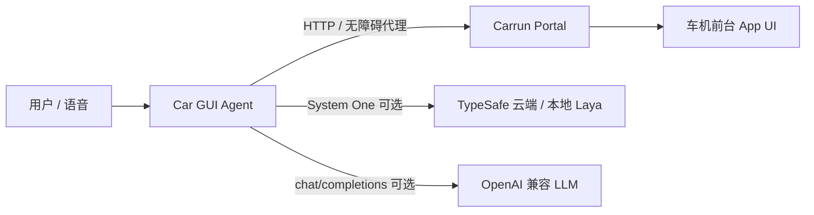
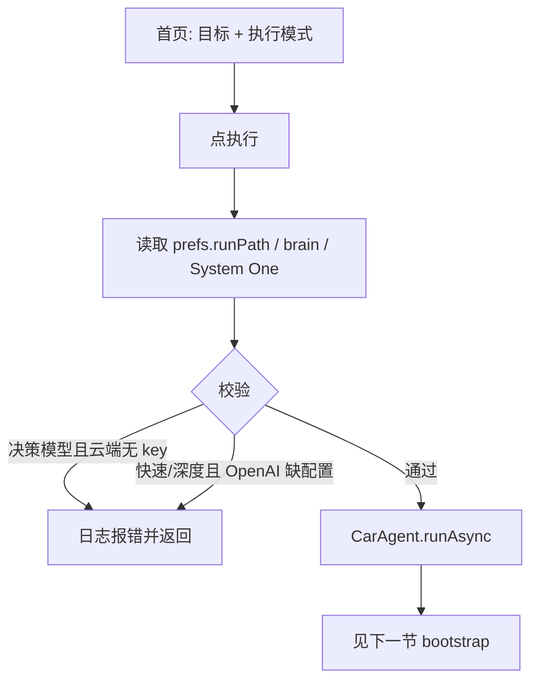
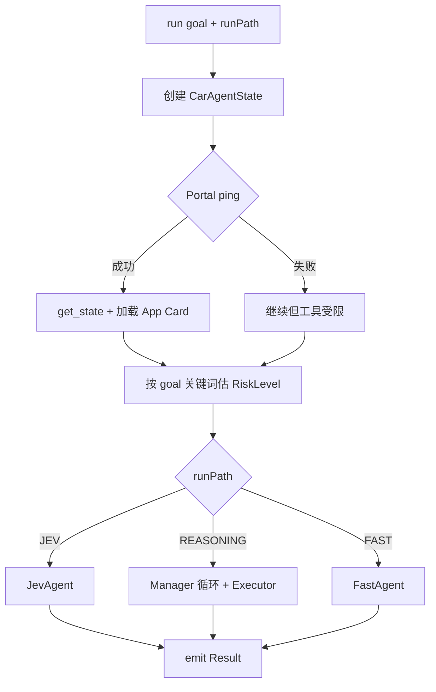
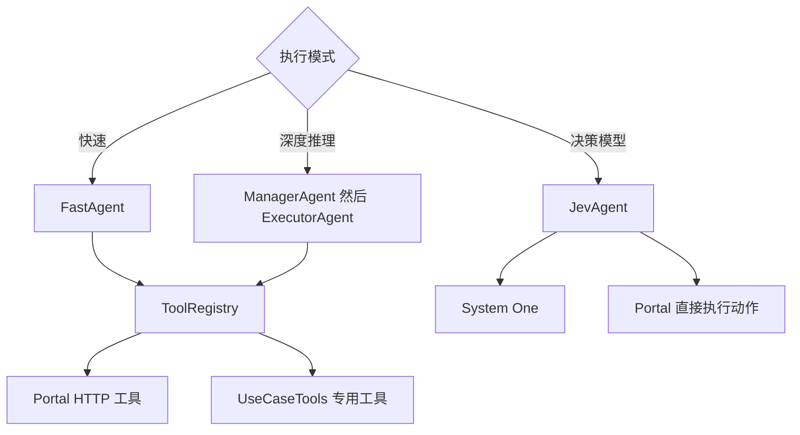
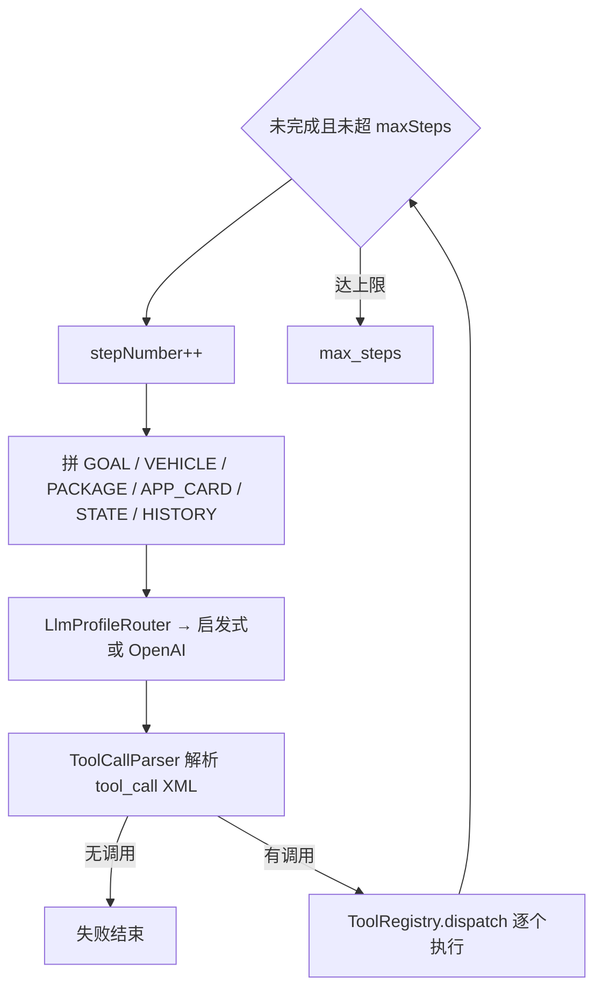
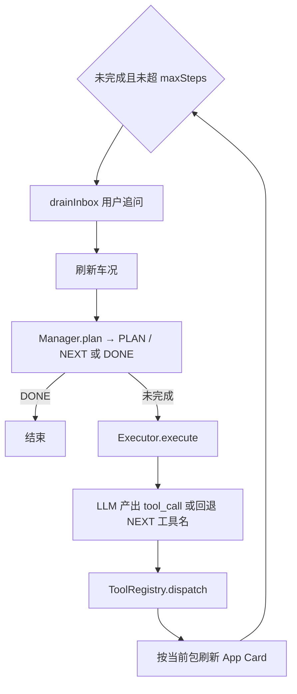
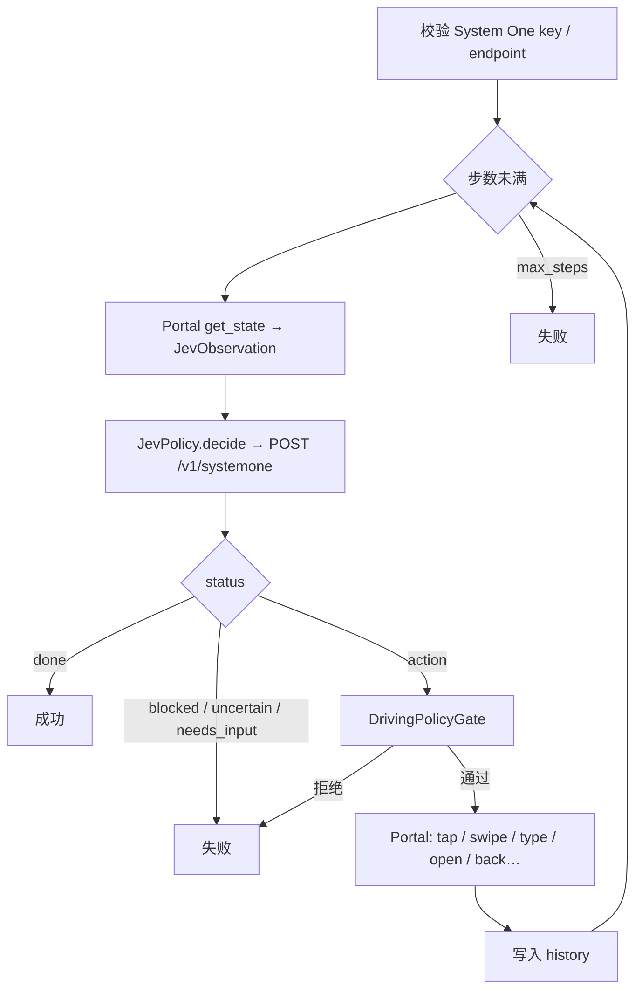
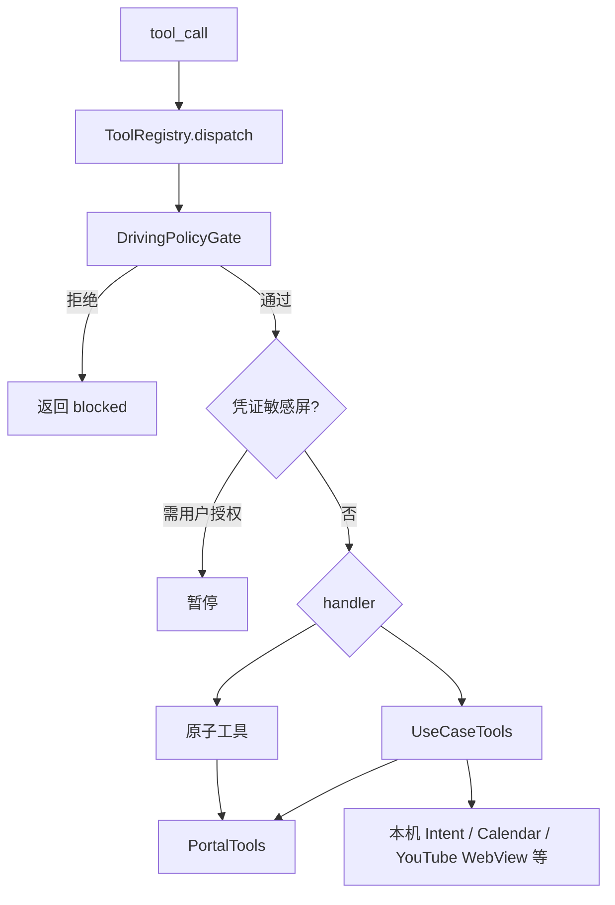
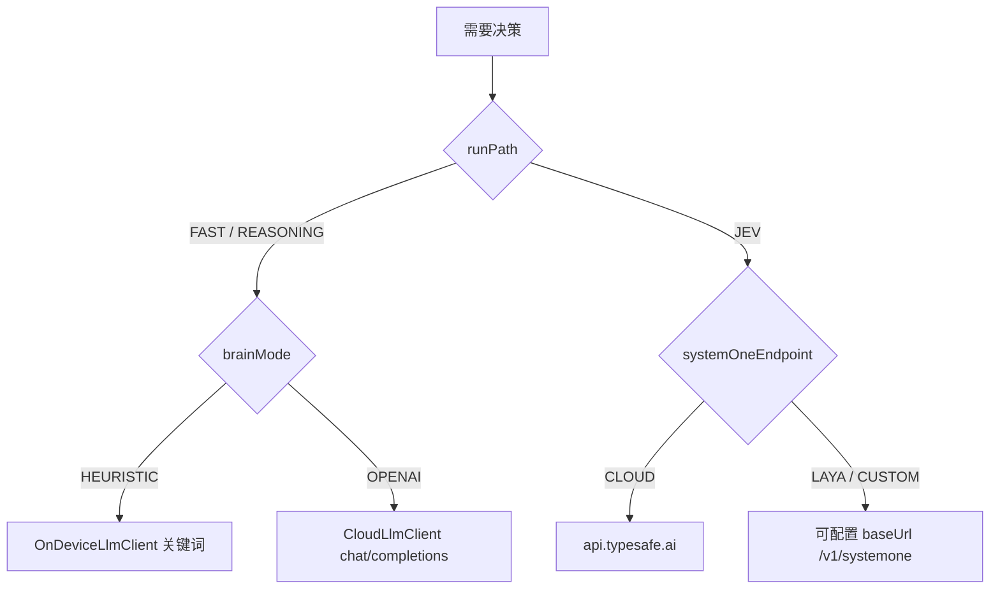

# Car GUI Agent 执行逻辑

本文描述 `:agent`（`com.carrun.caragent`）从用户点「执行」到结束的编排与分支。部署与配置说明见 [car-gui-agent.md](car-gui-agent.md)；Portal HTTP 见 [local-api.md](local-api.md)。

## 1. 双 APK 角色

| 组件 | 职责 |
| --- | --- |
| **Agent** | 编排（Fast / Manager+Executor / Jev）、策略门禁、用例工具、事件日志 |
| **Portal** | 本机无障碍、截图、点击/输入/全局键、通知缓冲等执行面 |
| **System One** | 仅「决策模型」路径的决策后端 |
| **LLM** | 仅「快速 / 深度推理」路径的规划后端 |

## 2. 从 UI 进入

首页 **执行模式**（`AgentRunPath`）决定编排，与配置页分区对齐：

| 首页选项 | `AgentRunPath` | 配置页相关 |
| --- | --- | --- |
| 快速 | `FAST` | 「快速 · 深度推理」→ LLM |
| 深度推理 | `REASONING` | 同上 |
| 决策模型 | `JEV` | 「决策模型」→ System One |

## 3. CarAgent 公共入口

入口：[`CarAgent.run`](../agent/src/main/java/com/carrun/caragent/agent/car/CarAgent.kt)。

公共准备：

1. `portal.ping()` / `get_state()` → `formattedDeviceState`、`currentPackageName`
2. [`AppCardLoader`](../agent/src/main/java/com/carrun/caragent/cards/AppCardLoader.kt) 按包名加载 `assets/app_cards/*/CARD.md`（没有则 `null`，不阻断）
3. `inferRisk(goal)`：含 youtube/网页/截图等 → HIGH；改设置类 → MEDIUM；否则 LOW
4. 按 `runPath` 三选一进入后文循环

## 4. 三条编排路径总览

| 路径 | 决策谁做 | 执行谁做 | App Card | UseCaseTools |
| --- | --- | --- | --- | --- |
| 快速 | LLM / 启发式 → `<tool_call>` | `ToolRegistry` | 有则进 prompt | 有 |
| 深度推理 | Manager 出 PLAN/NEXT；Executor 出工具 | `ToolRegistry` | 有则进 prompt | 有 |
| 决策模型 | System One 选候选动作 | `JevAgent.execute` → Portal | 不用 | **无** |

---

## 5. 快速（FastAgent）

实现：[`FastAgent`](../agent/src/main/java/com/carrun/caragent/agent/fast/FastAgent.kt)。

特点：单 agent、每步直接要工具调用；无 Manager 规划文本。

---

## 6. 深度推理（Manager → Executor）

实现：[`ManagerAgent`](../agent/src/main/java/com/carrun/caragent/agent/manager/ManagerAgent.kt)、[`ExecutorAgent`](../agent/src/main/java/com/carrun/caragent/agent/executor/ExecutorAgent.kt)；循环在 `CarAgent`。

每步两次 LLM（规划 + 执行），适合多步纠偏；代价更高。

---

## 7. 决策模型（JevAgent）

实现：[`JevAgent`](../agent/src/main/java/com/carrun/caragent/agent/jev/JevAgent.kt)、[`JevPolicy`](../agent/src/main/java/com/carrun/caragent/brain/jev/JevPolicy.kt)。对齐 mobile-jev：**observe → decide → execute**。

### 单步细节

1. **观察**：无障碍树 → 可见元素、包名、是否可编辑。
2. **决策**：从当前屏生成候选（点控件 / 滑 / 输入 / 返回 / 开 App / Wait / DONE…），连同 goal、历史、安装应用列表交给 System One。
3. **门禁**：OpenApp≈中风险，Wait≈低，其余点按/输入≈高。
4. **执行**：只走 Portal / `AppLauncher`，**不**调用 `yt_open`、`list_notifications` 等专用工具。
5. **历史** → 下一轮再观察，直到 DONE / 被拦 / 出错 / `maxSteps`（默认 15）。

System One 端点由配置决定（云端 TypeSafe / 本地 Laya / 自定义 base URL）。

---

## 8. 工具层（仅快速 / 深度推理）

### 原子工具

[`ToolRegistry.registerDefaults`](../agent/src/main/java/com/carrun/caragent/tools/ToolRegistry.kt)：

`get_state` · `click` · `click_at` · `long_press` · `swipe` · `type` · `type_secret` · `system_button` · `wait` · `open_app` · `take_screenshot` · `complete`

### 专用工具（用例）

[`UseCaseTools.handlers`](../agent/src/main/java/com/carrun/caragent/usecases/UseCaseTools.kt)，在 `CarAgent` 里以 `customHandlers` 注入：

| 场景 | 工具名 |
| --- | --- |
| 通知 / 日程 | `list_notifications` · `summarize_notifications` · `query_calendar` |
| 日式生活站 | `jp_lifestyle_open` |
| YouTube | `yt_open` · `yt_skip_ad` · `yt_seek` |
| 商品 / 截图 | `product_search` · `save_screenshot` |
| 设置 / 教程 | `speak_tutorial` · `open_settings_guide` |

无预定义场景时：不报错；启发式常退化为 `get_state` + `complete`；OpenAI 则靠通用 Portal 工具自行规划。

## 9. App Card

| 包名资产 | 用途摘要 |
| --- | --- |
| `com.android.chrome` | 浏览器导航注意点 |
| `com.google.android.youtube` | 优先 `yt_*` |
| `com.android.car.settings` / `com.android.settings` | 设置/教程安全确认 |
| `com.android.calendar` | 优先日历 API |

加载：`app_cards/<package>/CARD.md`；包名模糊匹配 chrome/settings/youtube/calendar。  
**无 CARD**：prompt 不带 `APP_CARD:`，继续执行。  
**Jev 路径**：不读 App Card。

## 10. LLM / System One 路由

启发式关键词与用例工具名的映射见 [`OnDeviceLlmClient`](../agent/src/main/java/com/carrun/caragent/brain/LlmClient.kt)。

## 11. 驾驶策略门禁

[`DrivingPolicyGate`](../agent/src/main/java/com/carrun/caragent/policy/DrivingPolicyGate.kt)（概念）：

- **低风险**：行驶中允许（摘要、日程、教程朗读等）
- **中风险**：驻车或低速（打开设置等）
- **高风险**：仅驻车（网页 GUI / YouTube / 截图检索、多数 Jev 点按）

首页「开发模拟 · 车况」可切换挡位/车速，用于联调门禁。

## 12. 关键代码索引

| 概念 | 位置 |
| --- | --- |
| 编排入口 | `agent/.../agent/car/CarAgent.kt` |
| 运行路径枚举 | `agent/.../config/AgentRunPath.kt` |
| Fast | `agent/.../agent/fast/FastAgent.kt` |
| Manager / Executor | `agent/.../agent/manager/` · `.../executor/` |
| Jev | `agent/.../agent/jev/JevAgent.kt` · `brain/jev/` |
| 工具注册 | `agent/.../tools/ToolRegistry.kt` |
| 用例工具 | `agent/.../usecases/UseCaseTools.kt` |
| App Card | `agent/src/main/assets/app_cards/` · `cards/AppCardLoader.kt` |
| System prompts | `agent/src/main/assets/prompts/` |
| 首页 / 配置 | `ui/MainActivity.kt` · `ui/SetupActivity.kt` |
